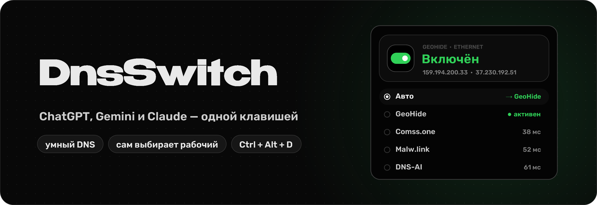

  

  ChatGPT, Gemini или Claude пишут «недоступно в вашей стране»? 
  <b>DnsSwitch</b> одной клавишей ставит на компьютер умный DNS, который открывает нейросети без VPN, 
  и так же быстро возвращает всё как было.

  
   
  Windows 10/11 · один файл, 370 КБ · бесплатно

---

## Что умеет

- **Одна клавиша.** `Ctrl + Alt + D` включает и выключает DNS. Сочетание можно поменять.
- **Видно сразу.** Значок в трее зелёный, когда DNS включён, и серый, когда выключен. Короткая плашка над панелью задач говорит, что произошло.
- **Много серверов и режим «Авто».** GeoHide (узлы в России и Европе), Comss.one, Astracat, Mafioznik, XyZ DNS, Malw.link, DNS-AI, Xbox DNS — всего 15. Программа проверяет, какие отвечают и какие на самом деле открывают нейросети, и сама берёт самый быстрый. Если сервер перестал работать, переключается на другой.
- **Список серверов обновляется сам.** Он лежит в [`presets.txt`](presets.txt). Когда какой-то DNS закрывается или появляется новый, список меняется здесь, и программа скачивает его без новой версии.
- **Свои DNS.** Настройки → «Открыть dns.txt», одна строка: `Имя | ip1, ip2 | https://…/dns-query`.
- **Шифрование.** На Windows 11 DNS работает через HTTPS (DoH), провайдер не видит запросы.
- **Возвращает как было.** При выключении ставит обратно твой прежний DNS, ручной или автоматический.
- **Сама запускается и обновляется.** Автозапуск с Windows без вопросов о правах администратора. Новую версию скачивает сама и предлагает обновиться одной кнопкой.

## Быстрый старт

1. Скачай `DnsSwitch.exe` из [Releases](../../releases/latest) и запусти.
2. Windows **один раз** спросит права администратора: без них DNS не поменять. Если появится синее окно «Windows защитила ваш компьютер», нажми «Подробнее» → «Выполнить в любом случае».
3. Программа сама установится в `AppData\Local\Programs\DnsSwitch`, добавит ярлык в «Пуск» и включит автозапуск. Скачанный файл после этого можно удалить.
4. Нажми `Ctrl + Alt + D` или кнопку «Включить» в окне.

Windows 11 прячет новые значки в трее под стрелку `^`. Перетащи значок DnsSwitch на панель, чтобы всегда видеть его цвет.

## Важно знать

- DNS меняется только на **проводном Ethernet**. Wi-Fi и VPN-адаптеры программа не трогает.
- Умный DNS снимает блокировку по стране IP, но не по аккаунту. Если в Google-аккаунте указана страна Россия, Gemini может не пустить и с ним.
- Серверы из списка принадлежат сторонним сервисам. Они видят, какие сайты ты открываешь, и могут закрыться в любой момент.

---

Исходный код закрыт.
